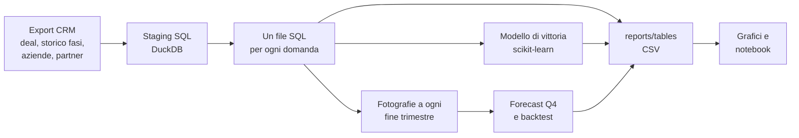

# Analisi della pipeline commerciale

*[Read in English](README.md)*

Ogni trimestre la direzione commerciale torna con le stesse domande. Dove perdiamo i deal? Su quale canale conviene investire? Stiamo crescendo o è solo agosto che fa agosto? Quanto vale davvero la pipeline, e quanto chiuderemo il prossimo trimestre? Il CRM ha tutti i dati per rispondere, ma i report standard rispondono ad altro: contano i deal, sommano gli importi, confrontano questo mese con il precedente.

Questo progetto è l'analisi che costruisco per rispondere sul serio a quelle domande, come faccio nel mio lavoro di operations data analyst: SQL per le metriche, Python per la statistica, il modello e il forecast, e ogni numero verificato contro qualcosa prima di arrivare sul tavolo di un direttore commerciale. I dati veri restano in azienda, quindi qui tutto gira su un export CRM sintetico (4.200 deal da gennaio 2024 a una fotografia al 30 settembre 2026) costruito per avere lo stesso tipo di andamenti che vedo nelle pipeline reali.

Lo stesso dataset alimenta anche la mia dashboard Power BI, in un repository separato: [powerbi-sales-dashboard](https://github.com/messimarco0701/powerbi-sales-dashboard). Questo repo è la parte di analisi, quello la parte di reporting.

## A cosa risponde

| Domanda | Dove | Come |
|---|---|---|
| Dove muoiono i deal? | [01_funnel.sql](sql/01_funnel.sql) | Conversione da una fase all'altra sui deal chiusi, `LAG` e `first_value` |
| Chi converte meglio, e la differenza è affidabile? | [02_win_rates.sql](sql/02_win_rates.sql) | Win rate per canale, segmento, prodotto, tipo di deal e quartile di importo (`NTILE`), con intervalli di Wilson calcolati in SQL |
| Quanto ci vuole a chiudere? | [03_sales_cycle.sql](sql/03_sales_cycle.sql), [04_stage_durations.sql](sql/04_stage_durations.sql) | Mediana, p75 e p90 dallo storico delle fasi |
| Quanto è concentrato il canale partner? | [05_partner_pareto.sql](sql/05_partner_pareto.sql) | Classifica con `ROW_NUMBER`, quota cumulata con una somma a finestra |
| I deal recenti sono peggiori o solo più giovani? | [06_cohorts.sql](sql/06_cohorts.sql) | Coorti mensili per data di creazione, con il loro grado di maturità |
| Com'è fatto un anno normale, e stiamo crescendo? | [07_seasonality.sql](sql/07_seasonality.sql), [08_yoy_ytd.sql](sql/08_yoy_ytd.sql) | Indice mensile per anno, confronto gennaio-settembre a parità di periodo |
| Quanto vale la pipeline aperta, e cosa è fermo? | [09_open_pipeline.sql](sql/09_open_pipeline.sql), [10_pipeline_by_stage.sql](sql/10_pipeline_by_stage.sql) | Pesata con le probabilità storiche di vittoria per fase, anzianità confrontata con il p90, `PERCENT_RANK` |
| Perché perdiamo? | [11_lost_reasons.sql](sql/11_lost_reasons.sql) | Motivi di perdita per fase, in colonna con aggregazione condizionale |
| Il mix dei canali sta cambiando? | [12_channel_mix.sql](sql/12_channel_mix.sql) | Quota trimestrale con una finestra sul trimestre |
| Quanto chiuderemo il prossimo trimestre? | [13_pipeline_snapshots.sql](sql/13_pipeline_snapshots.sql), [14_quarterly_bookings.sql](sql/14_quarterly_bookings.sql), [forecast.py](src/forecast.py) | Pipeline ricostruita a ogni fine trimestre, poi forecast e backtest |
| Che probabilità ha un nuovo deal di essere vinto? | [win_model.py](src/win_model.py) | Regressione logistica contro gradient boosting, split temporale |

Il racconto con grafici e commenti è nel notebook (in inglese): [notebooks/pipeline_analysis.ipynb](notebooks/pipeline_analysis.ipynb).

## Cosa emerge

Sono i numeri dell'esecuzione riportata nel [README in inglese](README.md#run-it), scritti come li presenterei a un direttore commerciale.

**1. Il canale è la leva più forte che abbiamo.** I deal da referral si vincono nel 53% dei casi, quelli da partner nel 33%, quelli diretti nel 23%, e gli intervalli di confidenza al 95% non si avvicinano nemmeno. L'upsell su clienti esistenti converte al 48% contro il 28% del new business. Il prodotto, invece, conta poco.

**2. Il fatturato chiuso cresce molto più dei deal creati, ed è un effetto mix.** Da gennaio a settembre 2026 il valore vinto è +69% sul 2025, con solo il 25% di deal creati in più. L'upsell è passato dal 13% al 27% dei nuovi deal, man mano che cresceva la base clienti, e i partner dal 38% al 43%. Entrambi convertono sopra la media. (Il +66% del 2025 sul 2024 è gonfiato: i dati partono a gennaio 2024 con una pipeline vuota.)

**3. Il canale partner ora è il più grande e anche il più concentrato.** I partner sono passati dal 31% al 45% dei nuovi deal e nel secondo trimestre 2026 hanno superato la vendita diretta. Nove partner su diciotto portano l'80% del valore vinto via partner, e il primo da solo il 28%. Quel rapporto merita un responsabile e un piano.

**4. La maggior parte dei deal muore presto e in silenzio, quelli costosi muoiono sul prezzo.** Un terzo dei deal persi non supera la Discovery, metà di questi per mancata risposta. Da Proposal in poi il 79% delle perdite è per prezzo o concorrenza. Qualificazione e pricing sono due problemi diversi, per due team diversi.

**5. I clienti grandi hanno bisogno di un altro calendario.** Un deal micro vinto chiude in una mediana di 27 giorni, uno large in 119, e un deal large su dieci supera i 200 giorni. Agosto vale circa un terzo di un mese medio, ogni anno: obiettivi mensili piatti "mancano" ogni estate.

**6. La pipeline aperta vale 1,44 milioni sulla carta e circa 0,62 una volta pesata.** 14 deal (138 mila) sono fermi nella loro fase da più tempo del 90% dei deal comparabili e vanno richiamati questa settimana.

**7. Q4 2026: circa 800 mila, con un intervallo da 620 mila a 1,14 milioni, e il rischio è verso l'alto.** Sui sei trimestri di backtest il metodo ha sbagliato in media del 17% ed è rimasto sotto quattro volte, del 43% nell'ultimo. Si basa sulle conversioni storiche, e le conversioni stanno migliorando. La stima puntuale implica +15% sul Q4 2025, mentre gli ultimi tre trimestri sono cresciuti tra il 65% e il 78% anno su anno: pianificherei sulla stima puntuale aspettandomi di superarla.


Tutti i tredici grafici sono in [reports/figures/](reports/figures/) e ogni tabella da cui nascono è un CSV in [reports/tables/](reports/tables/).

## Come funziona



Alcune scelte che vale la pena spiegare.

**Una domanda di business per ogni file SQL.** Ogni file si apre con la domanda a cui risponde, in un commento, e restituisce un solo risultato. Un collega che conosce SQL ma non Python può aprire [02_win_rates.sql](sql/02_win_rates.sql) e controllare esattamente come è definito un win rate, che è la prima cosa che chiunque chiede quando un numero sembra strano. Python si limita a eseguire i file in ordine e a fare quello in cui SQL è scomodo: modelli, forecast, grafici.

**I win rate arrivano con la loro numerosità.** Cinque punti di differenza su 2.000 deal sono un risultato, la stessa differenza su 200 è rumore. L'intervallo di Wilson è calcolato direttamente in SQL accanto a ogni tasso, e i grafici lo mostrano. Funziona meglio del classico p più o meno 1,96 errori standard quando i campioni sono piccoli o i tassi vicini a zero.

**Deal chiusi per i tassi, tutti i deal per la pipeline.** I deal aperti non hanno ancora avuto modo di vincere o perdere. Metterli in un funnel o in un win rate fa sembrare tutto peggio di quello che è, e le coorti più giovani peggio di tutte. Il grafico delle coorti lo mostra bene: agosto e settembre 2026 segnano 21% e 14% solo perché la maggior parte dei loro deal è ancora aperta.

**Un indicatore di deal fermi che confronta casi simili.** La prima versione segnalava i deal rimasti in una fase più a lungo del p90 di quella fase. Quasi tutti i deal segnalati erano Medium o Large, il che mi diceva soltanto che i deal grandi sono lenti. Adesso ogni deal è confrontato con i deal passati della stessa dimensione nella stessa fase, e la lista è qualcosa su cui un responsabile commerciale può davvero lavorare.

**Ricostruire il passato per un backtest onesto.** [13_pipeline_snapshots.sql](sql/13_pipeline_snapshots.sql) ricostruisce quali deal erano aperti, e in quale fase, alla fine di ogni trimestre dal 2024. Il forecast viene poi rifatto a ciascuna di quelle date usando solo le informazioni disponibili in quel momento. L'intervallo dato per il Q4 è quanto questo metodo ha sbagliato davvero, non una distribuzione ipotizzata.

**Ha vinto il modello semplice, e l'ho tenuto.** La regressione logistica arriva a una ROC AUC di 0,65 sul test e a un Brier score di 0,206 (0,224 per un modello che conosce solo il win rate medio). Il gradient boosting fa leggermente peggio su entrambi. Lo split è temporale: addestramento sui deal chiusi prima del 1° ottobre 2025, test sui deal creati dopo, così nessuna informazione dal futuro entra nel training. Le variabili sono solo quelle note alla creazione: niente fase, data di chiusura, motivo di perdita o durata del ciclo. Una AUC di 0,65 è modesta, ed è il risultato onesto: quasi tutto quello che decide un deal succede dopo che è stato creato.

**Un esperimento che non ho adottato.** Stimare i tassi per fase del forecast solo sugli ultimi due trimestri riduceva l'errore di backtest dal 17% a circa il 12%. Però quella finestra l'avevo scelta guardando gli stessi sei trimestri su cui veniva valutata, e con sei punti questo migliora il backtest più di quanto migliori il forecast. Ho lasciato la finestra espansiva, più semplice, e ho documentato la distorsione.

## Come si lancia

```bash
pip install -r requirements.txt
python src/generate_data.py     # facoltativo: ricrea i CSV sintetici in data/ (già nel repo)
python src/run_analysis.py      # esegue SQL, modello e forecast, scrive tabelle e grafici
python -m pytest                # verifica gli andamenti inseriti e lo split train/test
```

L'output completo sui dati di esempio è nel [README in inglese](README.md#run-it). I test verificano che l'SQL ritrovi quello che il generatore ha inserito (Referral sopra Partner sopra Direct con intervalli che non si sovrappongono, upsell sopra new business, agosto come mese più vuoto, la forma di Pareto dei partner, i clienti grandi più lenti a chiudere, la quota partner in crescita ogni anno) e che lo split del modello non possa avere leakage: ogni deal di training chiuso prima della data di taglio, ogni deal di test creato dopo, nessuna colonna "del futuro" tra le variabili.

## Struttura

```
data/        export CRM sintetico: deal, storico fasi, aziende, partner, commerciali
sql/         staging più un file per ogni domanda, nell'ordine in cui girano
src/         generatore di dati, runner SQL, modello, forecast, grafici, script principale
notebooks/   l'analisi raccontata, eseguita con gli output
reports/     tabelle dei risultati (CSV) e grafici (PNG)
tests/       andamenti inseriti e controlli sul leakage
```

## Dai dati sintetici a quelli veri

Nel lavoro l'input è un export del CRM preso via API invece che da CSV, e i risultati alimentano dashboard Power BI e una revisione trimestrale con la direzione commerciale. La struttura resta la stessa: uno staging che sistema i tipi e collega le dimensioni, una query per ogni domanda, tassi solo sui deal chiusi, intervalli accanto a ogni tasso, e un forecast verificato con un backtest prima che qualcuno veda un numero. Con dati veri aggiungerei i segnali di attività che questo dataset non ha (riunioni, email, giorni dall'ultimo contatto), che di solito sono quello che porta un modello di vittoria sopra 0,65.

## Strumenti

Python, DuckDB, SQL, pandas, NumPy, scikit-learn, matplotlib, Jupyter, pytest.

Tutti i dati di questo repository sono sintetici e vengono generati da [src/generate_data.py](src/generate_data.py) con un seed fisso. I nomi di aziende e partner arrivano da Faker. Gli andamenti sono inseriti di proposito, e il generatore li documenta, così ogni risultato riportato sopra si può confrontare con quello che è stato messo dentro.

## Progetti collegati

Questo repository fa parte di un piccolo portfolio costruito attorno allo stesso tipo di lavoro. La [pagina profilo](https://github.com/messimarco0701) spiega come si incastrano i pezzi.

| Progetto | |
|---|---|
| [crm-api-extractor](https://github.com/messimarco0701/crm-api-extractor) | Estrarre i dati dal CRM |
| [crm-billing-reconciliation](https://github.com/messimarco0701/crm-billing-reconciliation) | Controllarli con la fatturazione |
| [sales-pipeline-analytics](https://github.com/messimarco0701/sales-pipeline-analytics) | Analizzarli con SQL e Python |
| [powerbi-sales-dashboard](https://github.com/messimarco0701/powerbi-sales-dashboard) | Metterli davanti alle persone |
| [ai-contract-extraction](https://github.com/messimarco0701/ai-contract-extraction) | Portare i nuovi clienti nei sistemi |
