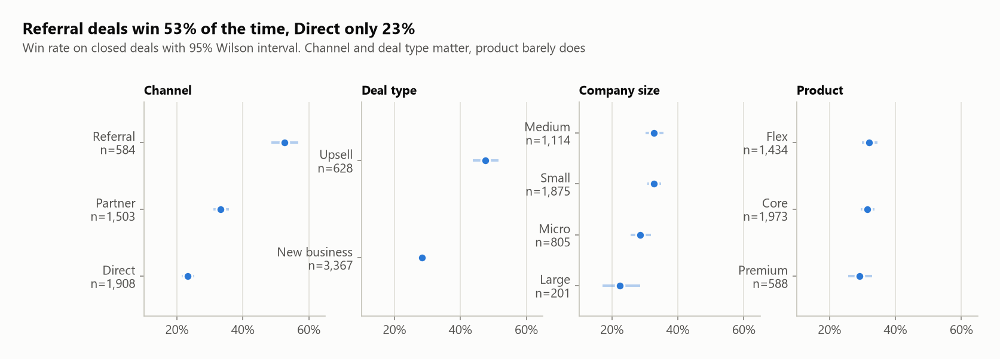
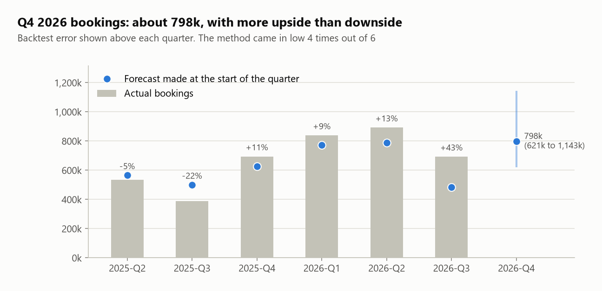
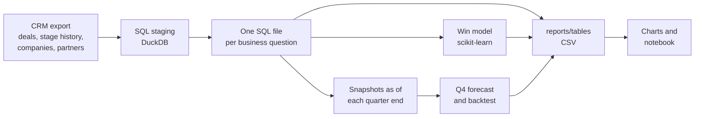

# Sales Pipeline Analytics

*[Leggi in italiano](README.it.md)*

Every quarter the same questions come back from sales management. Where do we lose deals? Which channel is worth investing in? Are we growing or is it just August being August? What is the pipeline really worth, and what are we going to book next quarter? The CRM has all the data to answer them, but the default reports answer different questions: they count deals, sum amounts and show this month against last month.

This project is the analysis I build to answer those questions properly, the way I do it in my job as an operations data analyst: SQL for the metrics, Python for the statistics, the model and the forecast, and every number checked against something before it goes in front of a sales director. The real data stays at work, so everything here runs on a synthetic CRM export (4,200 deals from January 2024 to a snapshot on 30 September 2026) built to have the same kind of patterns I see in real pipelines.

The same dataset also feeds my Power BI dashboard, in a separate repository: [powerbi-sales-dashboard](https://github.com/messimarco0701/powerbi-sales-dashboard). This repo is the analysis side, that one is the reporting side.

## What it answers

| Question | Where | How |
|---|---|---|
| Where do deals die? | [01_funnel.sql](sql/01_funnel.sql) | Stage to stage conversion on closed deals, `LAG` and `first_value` |
| Who converts best, and can we trust the difference? | [02_win_rates.sql](sql/02_win_rates.sql) | Win rate by channel, segment, product, deal type and size quartile (`NTILE`), with Wilson intervals in SQL |
| How long does it take to close? | [03_sales_cycle.sql](sql/03_sales_cycle.sql), [04_stage_durations.sql](sql/04_stage_durations.sql) | Median, p75 and p90 from the stage history |
| How concentrated is the partner channel? | [05_partner_pareto.sql](sql/05_partner_pareto.sql) | Ranking with `ROW_NUMBER`, running share with a window sum |
| Are recent deals worse, or just younger? | [06_cohorts.sql](sql/06_cohorts.sql) | Monthly cohorts by creation date with their maturity |
| What does a normal year look like, and are we growing? | [07_seasonality.sql](sql/07_seasonality.sql), [08_yoy_ytd.sql](sql/08_yoy_ytd.sql) | Monthly index per year, January to September like for like |
| What is the open pipeline worth, and what is stuck? | [09_open_pipeline.sql](sql/09_open_pipeline.sql), [10_pipeline_by_stage.sql](sql/10_pipeline_by_stage.sql) | Weighted by historical stage to win rates, aging against p90, `PERCENT_RANK` |
| Why do we lose? | [11_lost_reasons.sql](sql/11_lost_reasons.sql) | Lost reasons by stage, pivoted with conditional aggregation |
| Is the channel mix shifting? | [12_channel_mix.sql](sql/12_channel_mix.sql) | Quarterly share with a window over the quarter |
| What will we book next quarter? | [13_pipeline_snapshots.sql](sql/13_pipeline_snapshots.sql), [14_quarterly_bookings.sql](sql/14_quarterly_bookings.sql), [forecast.py](src/forecast.py) | Pipeline rebuilt as of every quarter end, then forecast and backtest |
| How likely is a new deal to be won? | [win_model.py](src/win_model.py) | Logistic regression vs gradient boosting, time-based split |

The story with charts and commentary is in the notebook: [notebooks/pipeline_analysis.ipynb](notebooks/pipeline_analysis.ipynb).

## Key findings

These are the numbers from the run below, written the way I would brief a sales director.

**1. Channel is the biggest lever we have.** Referral deals win 53% of the time, partner deals 33%, direct deals 23%. The 95% intervals do not even come close to overlapping. Upsell to existing customers converts at 48% against 28% for new business. Product, on the other hand, barely matters.

**2. Bookings are growing much faster than deal creation, and it is a mix effect.** January to September 2026 bookings are up 69% on 2025, with only 25% more deals created. Upsell went from 13% to 27% of new deals as the customer base grew, and partners from 38% to 43%. Both convert above average. (The +66% of 2025 on 2024 is inflated: the data starts in January 2024 with an empty pipeline.)

**3. The partner channel is now the largest and also the most concentrated.** Partners went from 31% to 45% of new deals and overtook direct sales in Q2 2026. Nine partners out of eighteen bring 80% of partner bookings, and the top one alone 28%. That relationship deserves an owner and a plan.

**4. Most deals die early and quietly, the expensive ones die on price.** A third of lost deals never get past Discovery, half of those for no response. From Proposal onwards 79% of losses are price or competitor. Qualification and pricing are two different problems for two different teams.

**5. Big customers need a different calendar.** A won micro deal closes in a median of 27 days, a large one in 119, and one large deal in ten takes more than 200 days. August runs at about a third of an average month every year, so flat monthly targets will "miss" every summer.

**6. The open pipeline is 1.44M on paper and about 0.62M once weighted.** 14 deals (138k) have sat in their stage longer than 90% of comparable past deals and need a call this week.

**7. Q4 2026 bookings: about 800k, range 620k to 1.14M, with the risk on the upside.** The method was off by 17% on average over six backtest quarters and came in low four times, by 43% in the most recent one. It is anchored on historical conversion, and conversion is improving. The point estimate implies +15% on Q4 2025 while the last three quarters grew 65 to 78% year over year, so I would plan on the point and expect to beat it.





All thirteen charts are in [reports/figures/](reports/figures/), and every table behind them is a CSV in [reports/tables/](reports/tables/).

## How it works



A few choices worth explaining.

**One business question per SQL file.** Each file starts with the question it answers in a comment, and ends with one result. A colleague who knows SQL but not Python can open [02_win_rates.sql](sql/02_win_rates.sql) and check exactly how a win rate is defined, which is the first thing anyone asks when a number looks surprising. Python only runs the files in order and does what SQL is bad at: models, forecasts, charts.

**Win rates come with their sample size.** A five point difference on 2,000 deals is a finding, the same difference on 200 is noise. The Wilson interval is computed directly in SQL next to every rate, and the charts show it. It behaves better than the textbook p plus or minus 1.96 standard errors when samples are small or rates are near zero.

**Closed deals for rates, all deals for pipeline.** Open deals have not had the chance to win or lose yet. Putting them in a funnel or a win rate makes everything look worse than it is, and the youngest cohorts look worst of all. The cohort chart shows exactly this: August and September 2026 read 21% and 14% only because most of their deals are still open.

**A stuck flag that compares like with like.** My first version flagged deals that had been in a stage longer than the p90 of that stage. Almost every flagged deal was Medium or Large, which only told me that big deals are slow. Now each deal is compared with past deals of the same size in the same stage, and the list is something a sales manager can actually work through.

**Rebuilding the past for an honest backtest.** [13_pipeline_snapshots.sql](sql/13_pipeline_snapshots.sql) reconstructs which deals were open, and in which stage, at the end of every quarter since 2024. The forecast is then replayed at each of those dates using only the information available on that date. The range given for Q4 is how wrong this method has actually been, not an assumed distribution.

**The simple model won, and I kept it.** Logistic regression reached a test ROC AUC of 0.65 and a Brier score of 0.206 (0.224 for a model that only knows the average win rate). Gradient boosting did slightly worse on both. The split is by time: trained on deals closed before 1 October 2025, tested on deals created after it, so no future information leaks into training. Features are only what is known at creation: no stage, close date, lost reason or cycle length. An AUC of 0.65 is modest, and that is the honest result: most of what decides a deal happens after it is created.

**One experiment I did not adopt.** Estimating the forecast's stage rates on only the last two quarters cut the backtest error from 17% to about 12%. But I picked that window by looking at the same six quarters it was scored on, and with six data points that flatters the backtest more than it improves the forecast. I left the simpler expanding window in place and documented the bias instead.

## Run it

```bash
pip install -r requirements.txt
python src/generate_data.py     # optional: recreates the synthetic CSVs in data/ (already committed)
python src/run_analysis.py      # runs the SQL, the model and the forecast, writes tables and charts
python -m pytest                # checks the planted patterns and the train/test split
```

Output on the sample data:

```
Deals: 4,200   closed: 3,995   won: 1,254   open at snapshot: 205

Win rate by channel (closed deals, 95% Wilson interval)
   value  closed_deals  win_rate  ci_low  ci_high
Referral           584     0.527   0.487    0.568
 Partner          1503     0.333   0.310    0.358
  Direct          1908     0.233   0.215    0.253

Jan-Sep like for like
 year  deals_created  deals_created_yoy  bookings  bookings_yoy  partner_share
 2024            910                NaN   862,760           NaN          0.310
 2025           1103              0.212 1,432,400         0.660          0.380
 2026           1380              0.251 2,422,720         0.691          0.432

Partners making 80% of partner bookings: 9 of 18   (top partner: 27.9%)

Open pipeline: 1,440,690   weighted: 622,167   stuck deals: 14 (138,060)

Win model, trained on 2,202 deals closed before 2025-10-01, tested on 1,629 created after it
              model  roc_auc  brier  log_loss
     Base rate only   0.5000 0.2237    0.6401
Logistic regression   0.6517 0.2060    0.6010
  Gradient boosting   0.6307 0.2115    0.6152

Forecast backtest
quarter  forecast  actual  error_pct
2025-Q2   565,035 535,850     -0.052
2025-Q3   499,284 388,720     -0.221
2025-Q4   627,599 694,240     +0.106
2026-Q1   771,505 838,210     +0.086
2026-Q2   788,668 891,970     +0.131
2026-Q3   483,709 692,540     +0.432

2026-Q4 bookings forecast: 798,149   range 621,403 to 1,142,733   (open pipeline part 417,102, new deals part 381,047)

Tables in reports/tables/, charts in reports/figures/
```

```
$ python -m pytest
10 passed in 2.77s
```

The tests check that the SQL finds what the generator planted (Referral above Partner above Direct with non overlapping intervals, upsell above new business, August as the quietest month, the Pareto shape of partners, larger customers closing slower, partner share rising every year) and that the model split cannot leak: every training deal closed before the cutoff, every test deal was created after it, no leaky column among the features.

## Project structure

```
data/        synthetic CRM export: deals, stage history, companies, partners, owners
sql/         staging plus one file per business question, in the order they run
src/         data generator, SQL runner, win model, forecast, charts, main runner
notebooks/   the analysis as a story, executed with outputs
reports/     result tables (CSV) and charts (PNG)
tests/       planted patterns and leakage checks
```

## Taking it to real data

At work the input is a CRM export pulled through the API rather than CSV files, and the results feed Power BI dashboards and a quarterly review with sales management. The structure stays the same: a staging layer that fixes types and joins the dimensions, one query per question, rates only on closed deals, intervals next to every rate, and a forecast that is backtested before anyone sees a number. With real data I would add the activity signals this dataset does not have (meetings, emails, days since the last touch), which are usually what lifts a win model above 0.65.

## Stack

Python, DuckDB, SQL, pandas, NumPy, scikit-learn, matplotlib, Jupyter, pytest.

All data in this repository is synthetic and generated by [src/generate_data.py](src/generate_data.py) with a fixed seed. Company and partner names come from Faker. The patterns are planted on purpose, and the generator documents them, so every finding above can be checked against what was put in.

## Related projects

This repository is part of a small portfolio built around the same kind of work. The [profile page](https://github.com/messimarco0701) explains how the pieces fit together.

| Project | |
|---|---|
| [crm-api-extractor](https://github.com/messimarco0701/crm-api-extractor) | Getting the data out of the CRM |
| [crm-billing-reconciliation](https://github.com/messimarco0701/crm-billing-reconciliation) | Checking it against billing |
| [sales-pipeline-analytics](https://github.com/messimarco0701/sales-pipeline-analytics) | Analysing it with SQL and Python |
| [powerbi-sales-dashboard](https://github.com/messimarco0701/powerbi-sales-dashboard) | Putting it in front of people |
| [ai-contract-extraction](https://github.com/messimarco0701/ai-contract-extraction) | Getting new customers into the systems |
